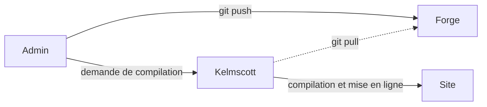
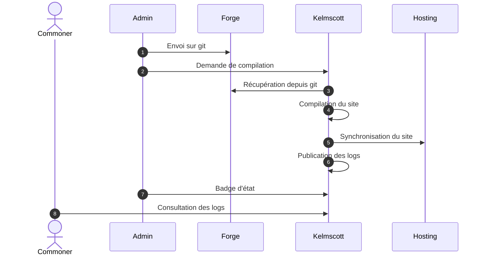
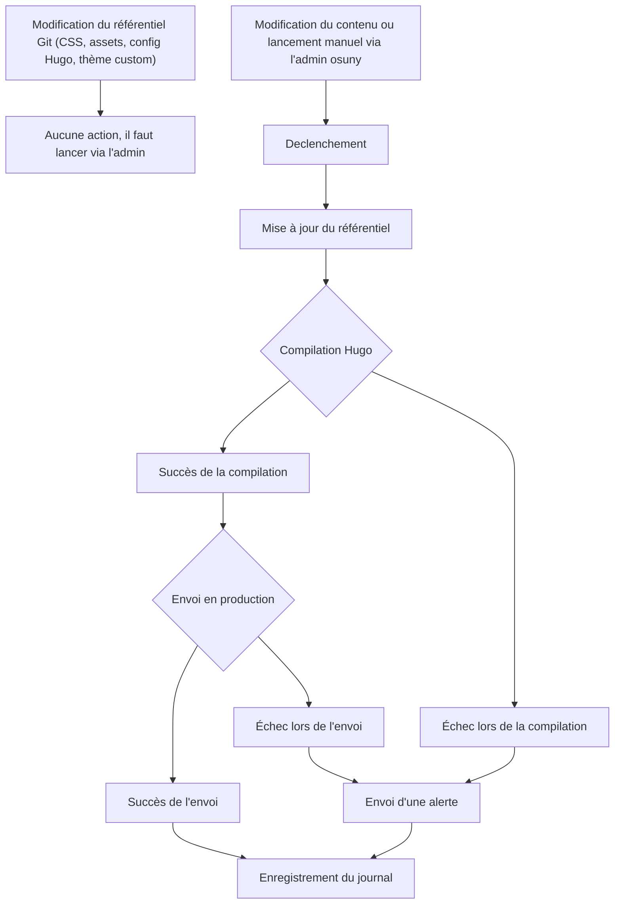
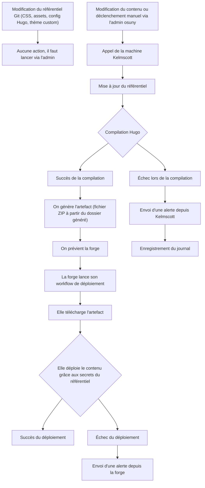
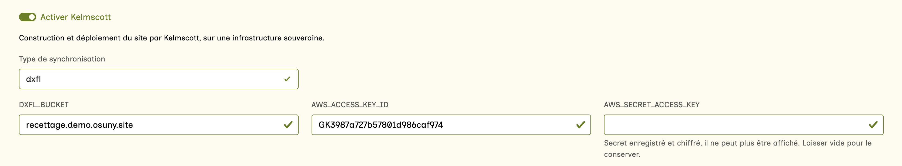
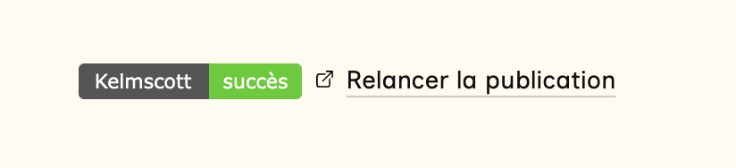

Kelmscott est une imprimerie de sites web.


C'est une machine qui :
- compile les sites Hugo
- met en ligne les sites compilés
- informe des erreurs
- garde un journal des compilations


## Contexte historique


La [Kelmscott Press](https://fr.wikipedia.org/wiki/Kelmscott_Press) représente l'aboutissement de la carrière de William Morris dans le domaine des arts graphiques, où il peut réaliser d'un bout à l'autre ses aspirations et mettre en application ses principes. Le nom vient du village de Kelmscott, où il a acquis le manoir du même nom. Morris aspire à retrouver le métier des anciens typographes, la prééminence du travail manuel sur la mécanisation et l'industrialisation. Dans un laps de temps relativement court, entre 1891 et 1898 (Morris disparaît en 1896), la Kelmscott Press produit 66 livres, inspirés par les incunables des premières années de l’imprimerie.

C'est ce que nous essayons de réaliser avec osuny : une publication artisanale de sites web.

## Architecture



## Séquence



Enjeux de sécurité
- Confidentialité des credentials (y compris dans les logs)
- Protection des processus (pour éviter le defacing)
- IP fixe -> Scaleway


{}

### Envoi sur git

L'admin push vers Git, comme actuellement.


  Risque déjà audité


### Demande de compilation

L'admin émet une requête vers Kelmscott pour demander une compilation, sur le chemin `université/site` : l'identifiant de l'université dans l'admin, puis le nom du dépôt du site.
La requête contient tous les paramètres : dépôt, mode de synchronisation, variables et secrets.
Elle est signée avec la clé privée de l'admin (Ed25519), qui n'existe que dans l'admin.
Kelmscott vérifie la signature avec la clé publique de l'admin : il ne peut pas lui-même fabriquer de requête valide.
La signature porte sur l'horodatage, le chemin et le contenu : une requête modifiée ou de plus de 5 minutes est refusée.
L'admin n'envoie la requête qu'en HTTPS.

```{filename="Requête POST"}
https://kelmscott.osuny.org/noesya/noesya-www
X-Kelmscott-Timestamp: 1791990000
X-Kelmscott-Signature: <signature de "horodatage, POST chemin, corps", en base 64>
```

```{filename="Payload"}
{
  "git_url": "https://github.com/noesya/noesya-www.git",
  "sync_method": "sftp",
  "variables": {
    "SFTP_HOST": "ftp.example.org",
    "SFTP_USER": "noesya",
    "SFTP_PASSWORD": "<base64 du texte chiffré>",
    ...
  }
}
```

Les variables dépendent du mode de synchronisation (`sftp`, `dxfl`, `rsync`, `s3`).
Dans l'admin osuny, les secrets sont chiffrés à l'enregistrement, avec la clé publique de Kelmscott (sealed box libsodium).
L'interface permet de remplacer un secret, comme les GitHub secrets, mais jamais de le relire : l'admin lui-même ne peut pas le déchiffrer.
Les variables non secrètes (hôte, utilisateur, chemin, bucket) restent lisibles dans l'admin, et ne sont protégées que par TLS pendant le transport.


  Risque d'usurpation d'identité et d'envoi de fausses données
  - limitation de la saisie aux admins
  - liste blanche des modes
  - liste blanche des variables
  - liste blanche des secrets
  - liste blanche des forges git (github.com, gitlab.com)
  - signature des requêtes par l'admin, avec horodatage
  - HTTPS obligatoire


### Récupération depuis git

Kelmscott clone le repo s'il n'existe pas, le met à jour s'il existe, submodules compris.
Seul le dernier commit est conservé (clone superficiel), et le dossier revient exactement à l'état distant.


  Il est important que les submodules soient connectés en HTTPS et non en SSH pour être récupérés correctement.



  Risque de remplissage du disque
  - sonde disque avec alerte


### Compilation du site

Kelmscott lance un processus autonome, sans les secrets : seule la synchronisation les reçoit.
Ce processus tourne dans un sandbox systemd, sous un utilisateur dédié sans droits (`kelmscott-build`), qui ne voit et ne peut écrire que le dossier de son site.
La compilation est reproduite entièrement, ce n'est pas un yarn osuny build, parce que c'est très inefficace de réinstaller tout le temps.
Les dépendances du thème viennent d'une toolchain partagée, en lecture seule, et aucun script npm du thème n'est exécuté.

```bash
hugo --minify
pagefind
```


  Risque d'exécution de code non maîtrisé
  - sandbox systemd, utilisateur sans droits limité au dossier du site
  - secrets absents de la compilation
  - commande de build globale


### Synchronisation du site

Kelmscott décrypte les secrets avec la clé privée. 
Kelmscott les fournit au script de synchronisation, sans les écrire nulle part.
Le site peut ajouter l'IP de Kelmscott à sa liste blanche.
La synchronisation s'exécute.


  Risque de sortie du dossier (lien symbolique) et de mise en ligne d'une compilation ratée
  - ignorer les liens symboliques
  - interrompre correctement le processus en cas d'échec de compilation


### Publication des logs

Les logs sont purgés des infos secrètes.
La sortie de la synchronisation est relue avant d'être écrite : chaque secret, et chaque ligne d'une clé SSH, est remplacé par `[secret masqué]`.


  Risque de publication de données secrètes
  - masquer les données confidentielles à l'écriture des logs


### Badge d'état

Le badge d'état affiche le succès ou l'échec de la publication.


  Pas de risque


### Consultation des logs

Les commoners peuvent consulter le dernier log, notamment pour débugger.
Les logs sont publics sur Kelmscott, et le badge renvoie vers eux.
Les secrets y sont masqués : il ne reste que des hôtes, des chemins et des noms de fichiers. Ce risque est accepté.


  Risque d'exposition de beaucoup d'infos
  - secrets masqués dans les logs
  - risque résiduel accepté : hôtes, chemins et noms de fichiers restent visibles


{}

## Flux

### 1. Tout dans Kelmscott (flux OK)

La version d'Hugo est globale dans Kelmscott.
Les alertes sont envoyées à Slack/Mattermost.
Le statut de compilation s'affiche en admin, à la place des badges de workflow.



Version optimale, à bien sécuriser.

### 2. Upload en CI (flux KO)

Cette version est plus sécurisée, parce qu'elle ne connaît pas les credentials.
En revanche, ça ne résout pas la question de l'IP unique, ça la délègue à la forge, et ça n'optimise pas vraiment les déploiements parce que ça complique le processus.



Version sous-optimale.

## Questions à résoudre

1. Comment envoyer les alertes ?

2. Comment mettre à jour la stack, notamment la version Hugo ?
Sebou ?

3. Chez qui héberger la machine ?
Scaleway ? Bearstech

## Implémentation

https://kelmscott.osuny.org

Instance CPU Scaleway


Indicateurs à monitorer :
- Espace disque
- RAM
- CPU

## Interfaces

### Admin



