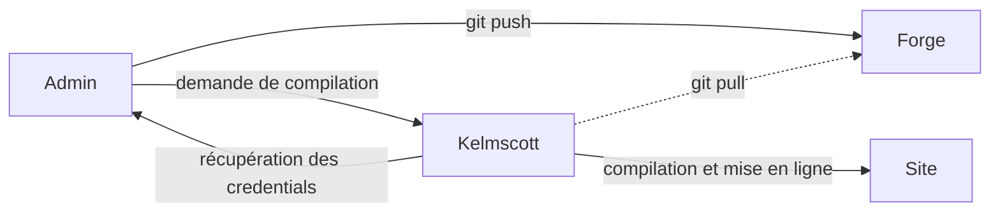
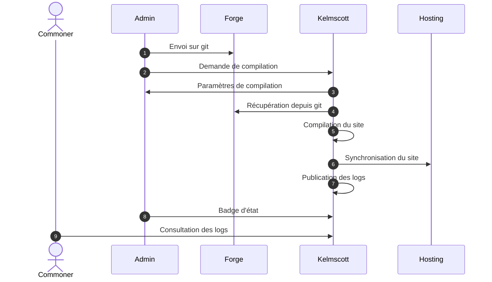
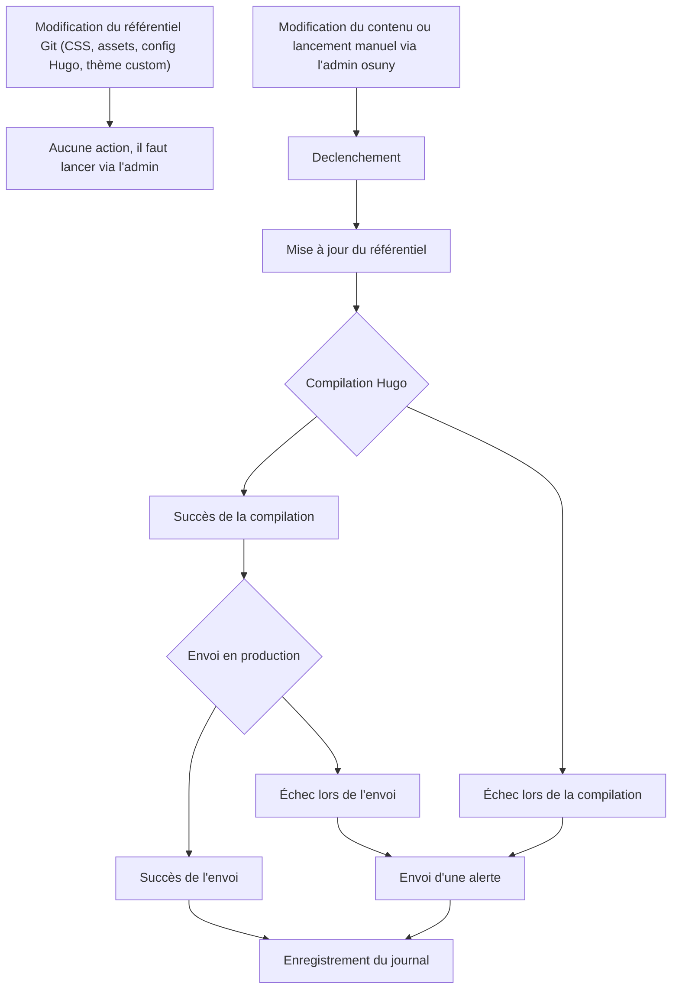
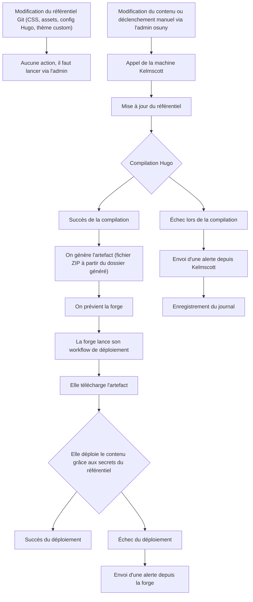
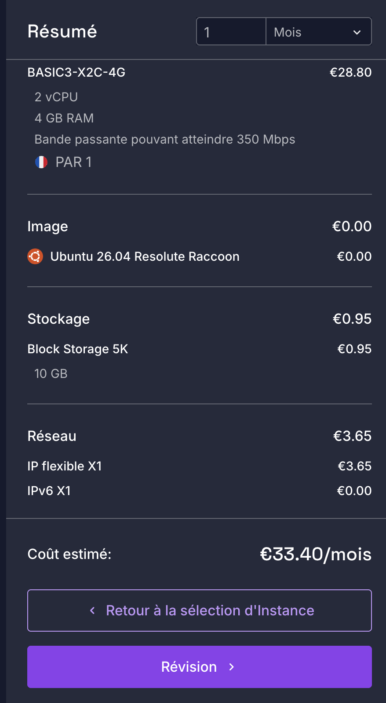

Kelmscott est une imprimerie de sites web.


C'est une machine qui :
- compile les sites Hugo
- met en ligne les sites compilés
- informe des erreurs
- garde un journal des compilations


## Contexte historique


La [Kelmscott Press](https://fr.wikipedia.org/wiki/Kelmscott_Press) représente l'aboutissement de la carrière de William Morris dans le domaine des arts graphiques, où il peut réaliser d'un bout à l'autre ses aspirations et mettre en application ses principes. Le nom vient du village de Kelmscott, où il a acquis le manoir du même nom. Morris aspire à retrouver le métier des anciens typographes, la prééminence du travail manuel sur la mécanisation et l'industrialisation. Dans un laps de temps relativement court, entre 1891 et 1898 (Morris disparaît en 1896), la Kelmscott Press produit 66 livres, inspirés par les incunables des premières années de l’imprimerie.

C'est ce que nous essayons de réaliser avec osuny : une publication artisanale de sites web.

## Architecture



## Séquence



Enjeux de sécurité
- Confidentialité des credentials (y compris dans les logs)
- Protection des processus (pour éviter le defacing)
- IP fixe -> Scaleway


{}

### Envoi sur git

L'admin push vers Git, comme actuellement.

### Demande de compilation

L'admin émet une requête vers Kelmscott pour demander une compilation
Kelmscott filtre les requêtes qui ne viennent pas du pool d'IP.
Un système de jeton ou de clé doit permettre de vérifier que la demande vient bien de l'admin osuny.

```{filename="Requête POST"}
https://compilation.osuny.org/noesya/noesya-www
```

### Paramètres de compilation

Kelmscott demande à l'admin osuny les infos pour compiler.
L'admin ne répond qu'à l'IP de Kelmscott.
Dans l'admin osuny, les informations de connexion sont stockées cryptées, avec la clé publique de Kelmscott.
L'interface doit permettre de mettre à jour une clé, comme les GitHub secrets.
Pas de vulnérabilité de ce côté, rien n'est en clair.

```{filename="Requête GET"}
https://noesya.osuny.org/compilation/noesya-www
```

```json
{
  "git" : {
    "url" : "https://github.com/osunyorg/noesya-www",
    "endpoint" : "https://github.com/osunyorg/noesya-www.git"
  },
  "sync" : {
    "mode" : "dxfl",
    "secrets" : {
      "ENDPOINT_URL" : "encoded value",
      "ACCESS_TOKEN" : "encoded value",
      "SECRET" : "encoded value",
    }
  }
}
```

### Récupération depuis git

Kelmscott clone le repo s'il n'existe pas, pull s'il existe.
Il faut mettre à jour les submodules, dans la branche choisie.

### Compilation du site

Kelmscott lance un processus autonome (avec un user aux droits limités ?). 
Ce processus install les dépendances, puis compile le site.

```bash
yarn install
yarn osuny build
```

### Synchronisation du site

Kelmscott décrypte les secrets avec la clé privée. 
Kelmscott les fournit au script de synchronisation, sans les écrire nulle part.
Le site peut ajouter l'IP de Kelmscott à sa liste blanche.
La synchronisation s'exécute.

### Publication des logs

Les logs sont purgés des infos secrètes.

### Badge d'état

Le badge d'état affiche le succès ou l'échec de la publication.

### Consultation des logs

Les commoners peuvent consulter le dernier log, notamment pour débugger.

{}

Le risque est la compromission root de Kelmscott, c'est tout.

## Flux

### 1. Tout dans Kelmscott

La version d'Hugo est globale dans Kelmscott.
Les alertes sont envoyées à Slack/Mattermost.
Le statut de compilation s'affiche en admin, à la place des badges de workflow.



Version optimale, à bien sécuriser.

### 2. Upload en CI

Cette version est plus sécurisée, parce qu'elle ne connaît pas les credentials.
En revanche, ça ne résout pas la question de l'IP unique, ça la délègue à la forge, et ça n'optimise pas vraiment les déploiements parce que ça complique le processus.



Version sous-optimale.

## Questions à résoudre

1. Comment déclencher les processus ?
2. Comment envoyer les alertes ?
3. Comment consulter les logs ?
4. Comment mettre à jour la stack, notamment la version Hugo ?
5. Chez qui héberger la machine ?

## Implémentation

Instance CPU Scaleway



Indicateurs à monitorer :
- Espace disque
- RAM
- CPU
