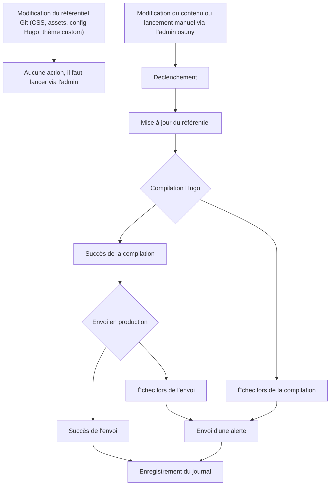
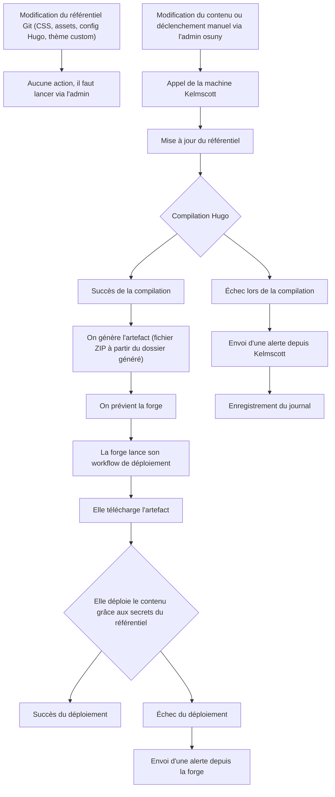

Kelmscott est une imprimerie de sites web.

C'est une machine qui :
- compile les sites Hugo
- met en ligne les sites compilés
- informe des erreurs
- garde un journal des compilations

## En savoir plus sur le nom

La Kelmscott Press représente l'aboutissement de la carrière de William Morris dans le domaine des arts graphiques, où il peut réaliser d'un bout à l'autre ses aspirations et mettre en application ses principes. Le nom vient du village de Kelmscott, où il a acquis le manoir du même nom. Morris aspire à retrouver le métier des anciens typographes, la prééminence du travail manuel sur la mécanisation et l'industrialisation. Dans un laps de temps relativement court, entre 1891 et 1898 (Morris disparaît en 1896), la Kelmscott Press produit 66 livres, inspirés par les incunables des premières années de l’imprimerie.

[Wikipédia](https://fr.wikipedia.org/wiki/Kelmscott_Press)

## Flux

La version d'Hugo est globale dans Kelmscott.
Les alertes sont envoyées à Slack/Mattermost.
Le statut de compilation s'affiche en admin, à la place des badges de workflow.

## Flux alternatif

## Enjeux

- Confidentialité des credentials (y compris dans les logs)
- Protection des processus (pour éviter le defacing)
- IP fixe -> Scaleway

## Questions à résoudre

1. Comment déclencher les processus ?
2. Comment envoyer les alertes ?
3. Comment consulter les logs ?
4. Comment mettre à jour la stack, notamment la version Hugo ?
5. Chez qui héberger la machine ?

## Implémentation

### Scaleway

Instance CPU

#### A monitorer

- Espace disque
- RAM
- CPU
